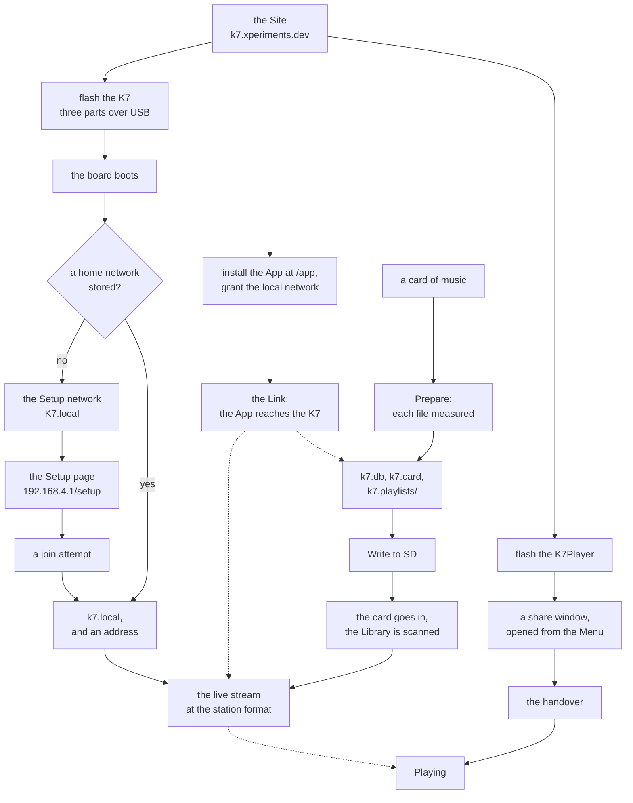
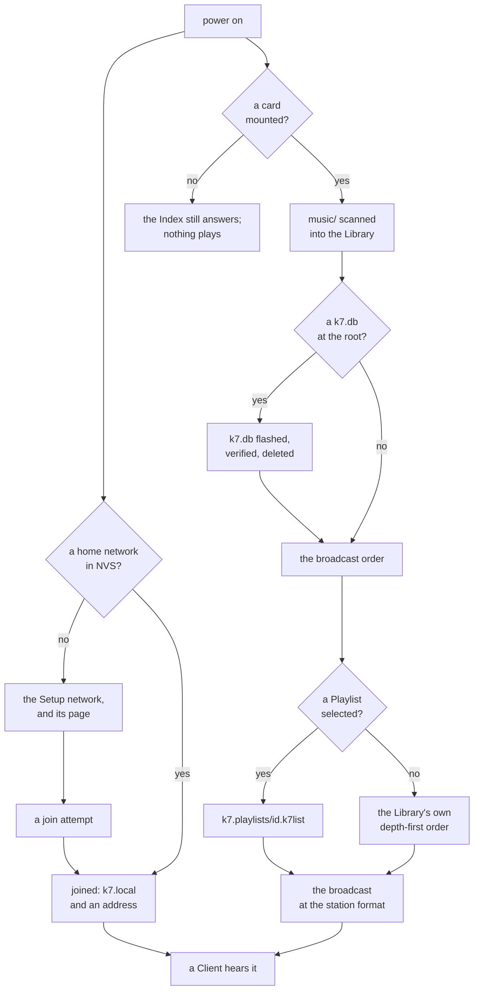
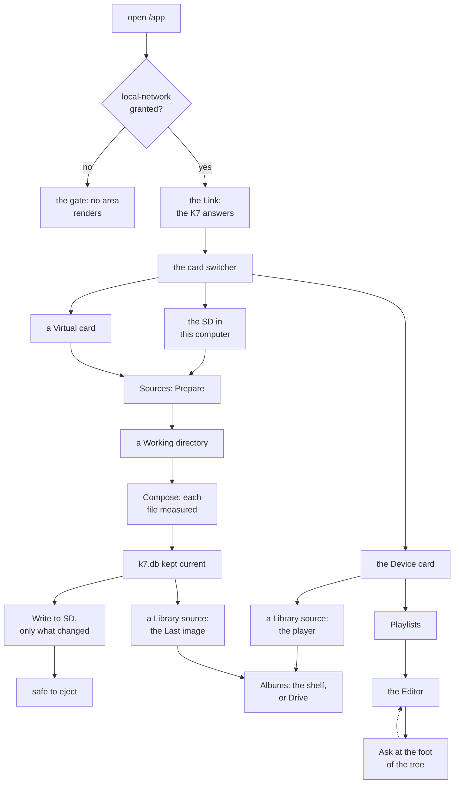
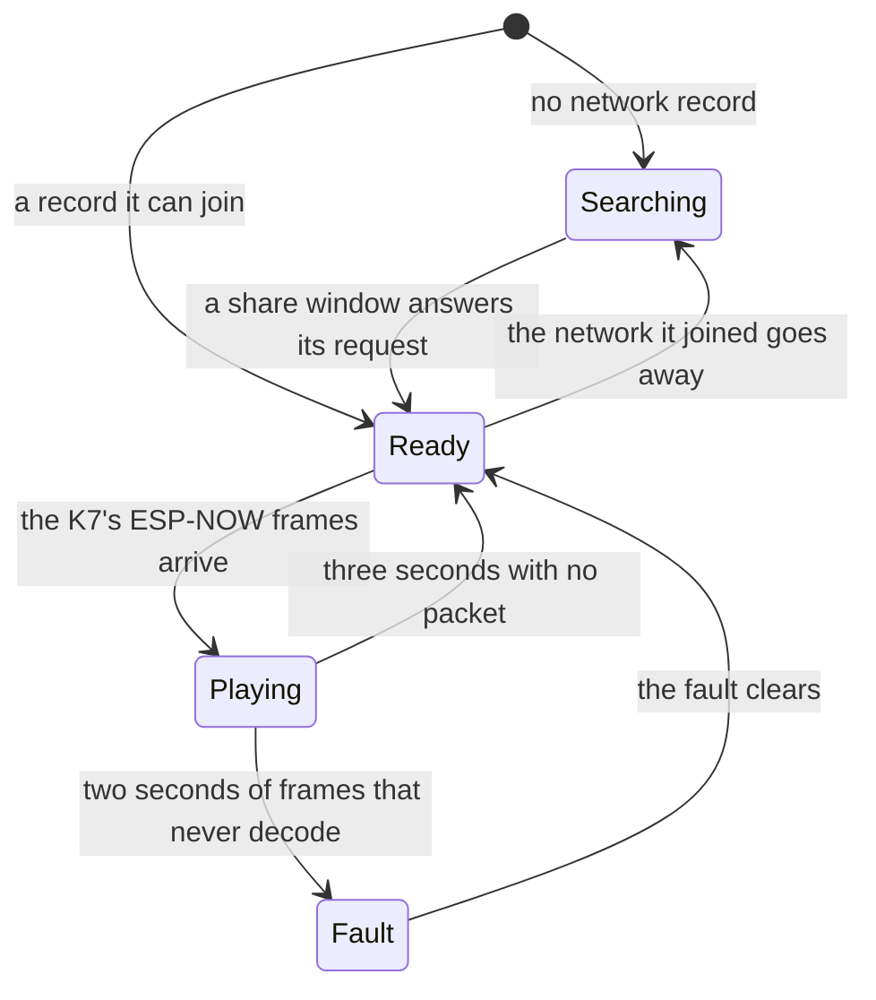
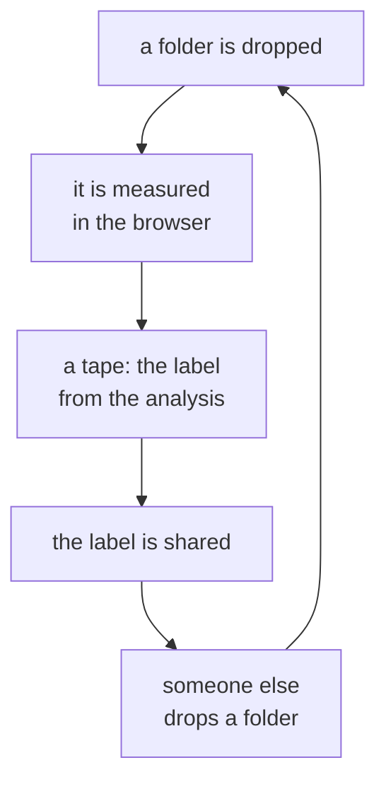

# The journey: from a bare board to music in the room

This page is a **map**, not a contract. Every step names the document that owns it —
[`wifi-provisioning.md`](./specs/wifi-provisioning.md) §2, [`k7-site.md`](./specs/k7-site.md) F11 —
and where this page and a document disagree, the document wins. It is not the manual
([`README.md`](../README.md)), which says how to build and flash, and it is not proof of anything on
a board, which is what the README's *Two-tier acceptance* is for. It adds no behaviour, no number
and no rule.

**The person.** The one actor in every diagram is **the person**: the human the product serves,
never an account and never a session. The diagrams differ by the state that person is in — no
hardware, a bare board, a card of music — not by a second noun.

**The table.** The diagrams carry no status, and §1's table does: one word and the evidence behind
it. **Measured** was run where it runs, with its date. **Built** exists in code with its tests, and
the missing proof is named. **Specified** is owned by a document and nothing is built. **Planned**
is only in the campaign's research.

---

## 1. The whole path

Walking it once, in order. A person opens the Site, writes the K7's three parts from the browser,
and the board comes up with no network — so it raises its own, the person gives it the home one,
and it answers at `k7.local`. The same person installs the App from the Site, grants the
`local-network` permission, and the App can reach the device directly. The music is prepared in
the App, on a card in the computer: every file measured, `k7.db` written beside the card's mark and
its lists, and the card goes into the K7, whose broadcast then starts. The player is the same shape
once more: flashed from the Site, given the network by the K7 inside a window a person opens, and
then only listening.

**The joins are the point.** Each context documents its own stretch. What passes between them — the
hand-off the Site's flash ends on, the gate that stands between an installed App and a device, the
card as the only way a measurement travels, the window that gives a player a network — is what this
page exists to show in one place.

### Every step, its owner, and the evidence

| Step | Owner | Status |
|---|---|---|
| The Site answers | [`k7-site.md`](./specs/k7-site.md) S1–S15 | **measured** · the live origin, 2026-11-20 ([`k7-deploy.md`](./specs/k7-deploy.md) §7) |
| Flash the K7 | [`k7-site.md`](./specs/k7-site.md) F1–F13 | **built** · the three parts written over USB by `esptool`, 2026-11-11 (34.0 s at 488.4 kbit/s); no board has been flashed from the browser |
| The Setup network, and its page | [`wifi-provisioning.md`](./specs/wifi-provisioning.md) P1–P4 | **measured** · board, 2026-11-10 (§10) |
| A join | [`wifi-provisioning.md`](./specs/wifi-provisioning.md) P4 | **measured** · board, 2026-11-10 (B2, B3) |
| `k7.local` answers | [`front-door.md`](./specs/front-door.md) §2, [`k7-app.md`](./specs/k7-app.md) L3 | **measured** · the README's board runs; the App's own fetch in Chrome 156 (`k7-app.md` A2) |
| Install the App | [`k7-site.md`](./specs/k7-site.md) S13, [`k7-app.md`](./specs/k7-app.md) A9–A13 | **built** · it ships; A13 is not re-signed on the real origin |
| The local-network grant, and the Link | [`k7-app.md`](./specs/k7-app.md) A3–A4 | **measured** · Chrome 156 on the deployed origin (`k7-app.md` A2) |
| A card is named in the header | [`k7-app.md`](./specs/k7-app.md) C4, [`card-mark.md`](./specs/card-mark.md) §3 | **built** · the mark's writer and its tests; a real FAT32 card is still owed (`k7-app.md` §11) |
| Prepare: each file is measured | [`k7-app.md`](./specs/k7-app.md) C1, [`snapshot.md`](./specs/snapshot.md) §2 | **built** · the App writes `k7.db`; no large-library pass is recorded |
| The card's own files | [`card-mark.md`](./specs/card-mark.md) §3, [`playlist-format.md`](./specs/playlist-format.md) §2 | **built** · both writers exist (ADR 0094); no board pass of the device's playlist write is recorded |
| Write to SD | [`k7-app.md`](./specs/k7-app.md) C1, ADR 0083 | **built** · the virtual card and the diff write; a real SD run is not recorded |
| The card goes in, the Library is scanned | [`sd-stream-server.md`](./specs/sd-stream-server.md) §3 | **measured** · 64 tracks, `scan=96 ms` (README) |
| The Update file is consumed | [`snapshot.md`](./specs/snapshot.md) §2 | **built** · the README calls the update path board-tier pending |
| The live stream plays | [`sd-stream-server.md`](./specs/sd-stream-server.md) §4 | **measured** · the board runs (README) |
| Flash the K7Player | [`k7-site.md`](./specs/k7-site.md) F2–F3 | **built** · all six parts are served (`k7-deploy.md` §7) and its firmware runs on a WROOM-32; no browser write has flashed it |
| A share window | [`network-handover.md`](./specs/network-handover.md) §3, [`menu.md`](./specs/menu.md) | **measured** · board, 2026-11-18 (§7) |
| The handover | [`network-handover.md`](./specs/network-handover.md) §5 | **measured** · board, 2026-11-18 (T11, T13, T15); the AP fallback (T14) is not |
| The player plays | [`k7player.md`](./specs/k7player.md) §4–§5 | **measured** · board, 2026-11-18 (B1, B5) |

---

## 2. The K7

The device's facts are **orthogonal**, not exclusive: a network is stored or not, a card is mounted
or not, a window is open or not, a Playlist is selected or not, in any combination. So this is a
flow of decisions, not a state machine — one moving dot would draw four independent facts as one.

The device is an appliance with a premise: it never serves a Track and never accepts one, so the
card is prepared outside it and audio leaves only as the live stream
([`sd-stream-server.md`](./specs/sd-stream-server.md)). Its writes are the three the premise names —
the Update file's delete, `k7.select`, and the Playlists the App sends — and nothing else. The Menu
is its one control surface: Browse walks the Library tree, Playlists selects one and the broadcast
walks it, Wi-Fi opens a share window, Settings holds the network
([`menu.md`](./specs/menu.md)). The panel and the Peek present the live stream and are never a
source of truth ([`CONTEXT.md`](./specs/CONTEXT.md#the-display)).

---

## 3. The App

The App is the producer of the **Snapshot**, and the selected card decides every question after
that: which Library source answers — the player, which reflects the card in it now, or the
**Last image**, which reflects the last run this browser made — and which copy carries the card's
**Playlists** ([`k7-app.md`](./specs/k7-app.md) S1–S6). A Playlist belongs to the card whose tracks
it names and lives on it, one file per list, so an edit is a **Draft** until the card takes it, and
its **Reach** says where the copy is and whether it is current (ADR 0092, ADR 0095). The Editor's
sources column is the card's tree and **Ask** beside it: the model writes an **Intent** — filters —
and never a result, so a wrong answer is visible in the rows ([`k7-app.md`](./specs/k7-app.md) P1–P3,
ADR 0086).

---

## 4. The K7Player

One state enum, and it is the whole surface: the light is the only thing the box has.

The light has four states and nothing between them (R31): **Searching** while it sweeps or retries
a network, **Ready** when it is on a network with nothing to play, **Playing** while audio leaves an
output, and **Fault** when the reason is not the network. The handover is not a pairing — the K7
answers one player inside a share window and remembers nothing afterwards (ADR 0098, ADR 0099).
The player has no transport, no volume and no page ([`k7player.md`](./specs/k7player.md) R2, R5,
R32), and whether the K7 emits over the radio at all is the **K7's** setting, so *Ready* can simply
mean that the K7 is not emitting (ADR 0105).

---

## 5. The loop the campaign wants

Not the product's path: the campaign's. It is drawn here because it is the one other route a person
takes through this project — the App's measurement, with no card and no device at the end of it.

The loop is the campaign's own claim — *"Drop a folder → watch it get measured → make a tape →
share the label → someone else drops a folder"*
([`campaign.md`](./research/marketing/campaign.md) §9.2) — and it is **planned**: the pages it
names, a demo and a generated label at `/tape/:id`, do not exist, and the marketing site has not
been built. What is real is the other half: the K7 prints labels from the Snapshot's own Slots
([`label-templates.md`](./specs/label-templates.md)), and the editor that designs them exists in
`tools/LabelEditor/`.

---

## Keeping this page true

A step whose owner changed is the signal to edit this page: the table names one document per step,
so a spec that moves, splits or retires a requirement leaves a row that no longer points at it.
Nothing here is checked by CI; the README's *Two-tier acceptance* and the specs' own status lines
are the record, and this page only points at them.
