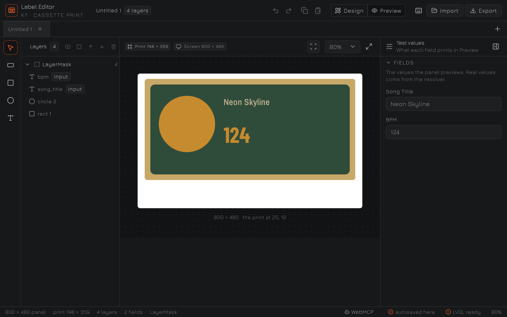
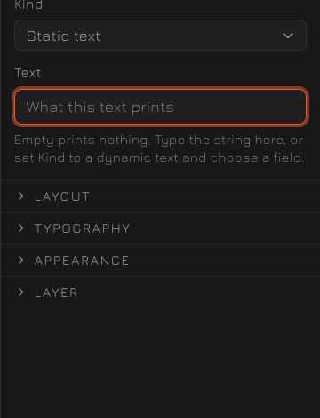
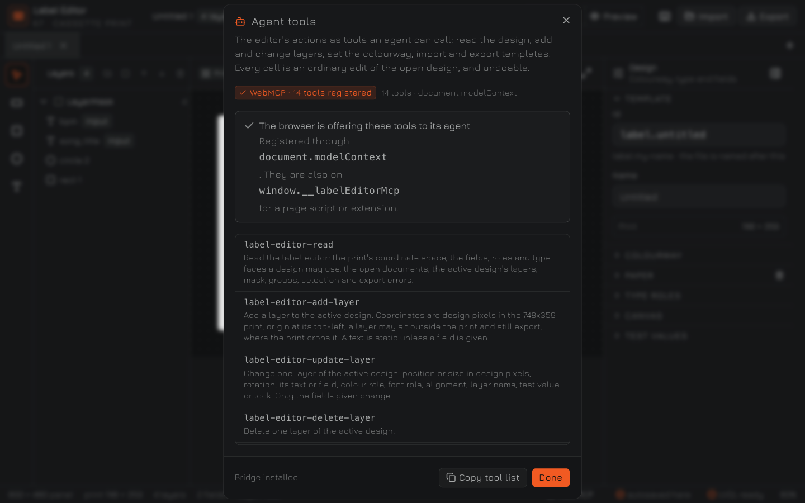

# K7Art Editor

The cassette artwork's design tool: the **label** the K7 prints at its one real size (748 × 359
at 25, 19 on the panel's 800 × 480 screen), and the **J-card** the webapp draws on an album
that has no cover picture (one 4.0625 × 4 in sheet, flap | spine | cover). Both are one
**K7Art** file in `assets/k7art/`; **Export** writes it and **Publish** writes a `.k7artpack`
the K7 app installs.

It is served at `/k7art`
([ADR 0112](../../docs/adr/0112-the-k7art-editor-is-the-sites-k7art-page.md)); [`npm run dev`](#running-it)
stays at 5178 for development. It replaces the one-page HTML builder it grew out of: same
document model, same template JSON, same exports, on React and the ReUI design system.




```bash
cd tools/LabelEditor
npm install
npm run dev        # http://localhost:5178
npm test           # the template and zip engines
npm run e2e        # Playwright, in the installed Chrome
npm run e2e:webmcp # only the native WebMCP test (skips if Chrome has no API)
npm run test-label  # build a test label (HOLA) through the tool surface
npm run typecheck
npm run build      # dist/
```

## What it does

- **Two surfaces, two media.** The label surface is the panel's geometry: the print where the
  device prints it, the pasteboard around it where a layer may bleed, and every layer outside
  the print marked. The J-card surface is one 4.0625 × 4 in sheet at 320 units per inch, with the
  flap | spine | cover guides and a focus for each; the palette and the faces are shared.
- **Documents.** Several K7Arts open at once, autosaved to `localStorage`. Documents made in
  the one-page builder (`lvgl-canvas.docs.v1`) or in the retired `label-template v1` format are
  migrated on first load.
- **Import.** The **Import** button, `⌘O`, the Export menu's *Import a JSON file*, or a `.json`
  dropped anywhere on the window: a **K7Art** or an editor document opens in a new tab, and a
  retired `label-template v1` file is migrated into a K7Art with a starter J-card. Anything the
  packer would refuse is refused on the way in, with the reason, and leaves no half-open tab
  behind.
- **The label and the J-card.** Every layer carries its own colour: a shape's fill, a text's
  type, a J-card layer's paint. The three faces are shared by both surfaces, and the label's
  background is the **mask** (a colour and a corner radius) while the J-card's is its own
  **background**. The label has the canvas background presets and the active one, its three
  compiled type pairs, its Slots and test values, groups and the LayerMask, which clips to a
  rounded print. The J-card has its own three type sizes, its `title`/`artist`/`meta`
  fields and its safe square.
- **A selection that moves, turns and scales as one.** One layer's corner resizes its own box; a
  group — or a ⌘-click selection — turns about its bounds and scales from their far corner, every
  member following, with one factor for both axes so a circle stays a circle and a rotated layer
  stays a rotated layer. A text's box scales with the rest and its type does not: a type role is
  one of the sheet's three compiled pairs (or, on the J-card, one of its three sizes), not a size
  of the layer's own.
- **An inspector that gives the open section the whole column.** Sections open one at a time
  (click the open header to close it), so no section is half-hidden behind a scrollbar; the
  inspector itself collapses to a rail and remembers that across reloads. An empty static
  text says so — a placeholder and a line under the field, and an `empty` badge in Layers.

  
- **Real preview for the label, the DOM for the paper.** The label is drawn by LVGL 9.6 compiled
  to WebAssembly (`public/lvgl.js`), the same build the panel runs, with the aperture. The J-card
  is drawn in the DOM at its own units, with the safe square, because the webapp draws it and
  there is no firmware rendering of a J-card.
- **Export and Publish.** Export writes one **K7Art** file for `assets/k7art/`; Publish writes a
  `.k7artpack` — the binary label sheet, the designs' J-cards and a header — for the K7 app to
  install. Both refuse what the packer would refuse, with the reason on screen.

## How it is built

```
src/engine/     the model and every operation: one Editor store, no React
src/components/ the views: app bar, tool rail, layers, canvas, inspector, dialogs
src/engine/tpl.ts   the template JSON: build (one view of a document) and import (its inverse)
src/engine/editor.ts  documents, undo, selection, gestures, masks, groups, the LVGL preview
public/lvgl.js  the emscripten build, with its wasm inlined as a data URI
public/fonts/   the three faces the sheet compiles, from assets/fonts/
```

The `Editor` is one external store (`useSyncExternalStore`); a view calls a method and the
whole app re-renders. That is why the canvas, the layer list and the inspector cannot disagree.

The chrome is sized in rem from a 125% root (`src/index.css`), so type, controls, spacing and
panel widths scale together. The label's own type is design pixels (inline `px` on the stage)
and never scales with the browser's text size.

The render is React; the geometry is the document's own pixels. A layer is a `<div>` at its
design coordinates inside a stage scaled by the zoom, which is also why the pointer maths is
`(clientX − stage.left) / zoom`.

## Coupling to the repository

- **The vocabulary.** `src/engine/vocab.generated.ts` is a generated copy of
  `assets/labels/vocabulary.json`, inside the markers `tools/label_pack.py` writes between.
  `python3 tools/label_pack.py --check-vocabulary` refuses it when it is stale, and
  `make -C host label` runs that check, builds this app and boots the built page in headless
  Chrome. The faces it offers are files in `public/fonts/`, checked byte for byte against the
  ones `assets/fonts/` compiles. There is no second copy of the editor to drift from.
- **The label section's bytes are unchanged; the file is a K7Art.** The label section's
  `tplBuild`/`tplImport` compare byte for byte with the one-page builder's output for a default
  design and for a complex design with an aperture, a rotated rect, a static text and two slots;
  the container adds the J-card, and the J-card's writer is checked against the webapp's renderer.

## Browser tests and connecting

`npm run e2e` drives the Chrome already on the machine (`channel: "chrome"` in
`playwright.config.ts`, so there is no browser download) and starts `npm run dev` itself.
`e2e/editor.spec.ts` covers the boot, the inspector's one-section-at-a-time behaviour (and
that the open one cannot be closed), collapsing the inspector with the state surviving a
reload, importing a template, and grouping two layers. `npm run e2e:ui` opens the
interactive runner.

To look at a browser you are already using, give that Chrome a debugging port:

```bash
"/Applications/Google Chrome.app/Contents/MacOS/Google Chrome" \
  --remote-debugging-port=9222 \
  --user-data-dir=/tmp/k7-debug \
  http://localhost:5178

npm run connect     # in another terminal: prints the state, writes docs/connected.png
```

`connect` prints the viewport, the root font size, whether the inspector is collapsed (and
its stored flag), the open documents, the zoom, and each inspector section's open state, then
takes a screenshot. `window.__editor` is exposed in development, so the same script can read
any editor state you want to add.

## WebMCP: the editor's actions as agent tools

On load the editor offers its actions to the browser as WebMCP tools, named `k7art-*`:
`document.modelContext.registerTool(tool, { signal })`, with `navigator.modelContext`
as the fallback older builds use. WebMCP is a Chrome 146+ preview behind
`#enable-webmcp-testing`; without it nothing is registered and the app is unchanged. The tools
edit one K7Art — the label surface and the J-card surface, each by name — and publish its pack.

There is deliberately **no external MCP server** — nothing on stdio, nothing on HTTP. The
tools live in the page that owns the design, so an MCP client reaches them through a
browser: native WebMCP, the bridge below, or Playwright (`scripts/test-label.mjs`). A server
would have to own a page to be useful, and then two places would hold the same design.

A session that will not fetch a route still gets the guide: `k7art-guide` returns it as
a tool result. A session that cannot call the tools at all can still make the label — the same
guide says which visible controls do what.

| Tool | What it does |
|---|---|
| `k7art-read` | Both surfaces — the label's coordinate space, fields, each layer's colour and type pairs, and the J-card's sheet, parts, background, fields and sizes — the open K7Arts, the active surface, layers, mask, groups, selection and export errors. |
| `k7art-guide` | The guide to designing a K7Art in one result — the print and the Card's window, the J-card sheet and its parts, the fields, the workflow, the refusals, and the visible-controls path. The same file is served at `/k7art/skill.md`; this is for a session that blocks routes. |
| `k7art-add-layer` | Add a rect, square, circle or text on the active surface; on the J-card, a text is static unless it names `title`, `artist` or `meta`. |
| `k7art-update-layer` | Change one layer's surface, position, size, rotation, text or field, colour, font role, alignment, name, test value or lock. |
| `k7art-delete-layer` | Delete a layer. |
| `k7art-select-layer` | Select layers, so the person at the screen sees what the agent is working on. |
| `k7art-move-layer` | Raise, lower, or send a layer to the top or bottom of the stack. |
| `k7art-group-layers` | Group the selection, or ungroup it. |
| `k7art-set-design` | The K7Art's id and name, the label's mask colour and radius, the label's canvas cycle and preview, a type role's face and size (the label's compiled pair, the J-card's size), and the J-card's background. |
| `k7art-set-field-value` | Set what a Slot (the label) or a J-card field previews. |
| `k7art-import-template` | Open a K7Art object (or JSON text) in a new document, with the packer's refusals; a `label-template v1` file is migrated. |
| `k7art-export-template` | Return the active or a named K7Art as `k7art v1` plus the errors that would stop an export. |
| `k7art-publish-pack` | Build a `.k7artpack` from named designs, with the browser packer's sheet and parity checks, and return it (or its errors). |
| `k7art-validate` | Check every open K7Art and return the reasons any would not export. |
| `k7art-document` | New, switch, rename or close a document. |
| `k7art-history` | Undo or redo. |

The same tools are always on the page, with or without the browser API:

```js
const design = await window.__k7artMcp.call("k7art-read");
await window.__k7artMcp.call("k7art-add-layer", {
  type: "text",
  text: "Side A",
  x: 40,
  y: 300,
  color: "#b9ac8e",
});
const tools = window.__k7artMcp.tools();   // name, description, inputSchema
const status = window.__k7artMcp.status(); // { available, via, registered, tools }
```

The status bar's **WebMCP** button opens *Agent tools*: the registration state, every
tool with its description, and a copy of the list as JSON.

 Each call is an ordinary edit
of the open design — it updates the UI and is undoable. No tool downloads a file or calls
the network; import takes a template object and export returns one.

`e2e/webmcp.spec.ts` stubs `document.modelContext`, asserts all 16 tools register, runs
add/update/read/export through them, and checks that a refused call changes nothing. A
second test removes the API and asserts the bridge still works.

`e2e/webmcp-native.spec.ts` uses Chrome's own WebMCP instead: the `webmcp-native` project
launches Chrome with `--enable-features=WebMCP` (the feature behind the
`#enable-webmcp-testing` flag), waits for the 16 tools, and adds a text through
`document.modelContext.executeTool`. It skips on a Chrome that does not expose the API, so
`npm run e2e` stays green everywhere.

Three ways to try it by hand:

1. **No flag, the bridge.** `npm run dev`, then in the console:
   ```js
   await window.__k7artMcp.call("k7art-read");
   await window.__k7artMcp.call("k7art-add-layer", {
     type: "text", text: "Side A", x: 40, y: 300,
   });
   ```
   The canvas and inspector update; `k7art-history` undoes it.
2. **The real API in this Chrome.**
   ```bash
   "/Applications/Google Chrome.app/Contents/MacOS/Google Chrome" \
     --enable-features=WebMCP \
     http://localhost:5178
   ```
   Open the status bar's **WebMCP** button: it should say *16 tools registered* through
   `document.modelContext`. In the console:
   ```js
   const tools = await document.modelContext.getTools();
   const tool = tools.find((t) => t.name === "k7art-read");
   JSON.parse(await document.modelContext.executeTool(tool, {}));
   ```
   Chrome's testing API returns a tool's result as JSON text, which is why the result is
   parsed here.
3. **Automated, watching.** `npm run e2e:ui` opens the interactive runner; tick
   `webmcp.spec.ts` (the stub) or run `npm run e2e:webmcp` for the native path.

## Designing a label with an agent

The editor ships a skill for agents:
[`skills/k7-art/SKILL.md`](skills/k7-art/SKILL.md). It is the guide
to a K7Art — the label's print and the Card's window, the J-card's sheet and its parts, the
fields, the three faces — plus a tool reference generated from the page's own registry. The dev
server serves it at `http://localhost:5178/skill.md`, the Site at `/k7art/skill.md`, and a build
emits `dist/skill.md`, so an agent that can read the page can read what its tools are for.

[`docs/label-prompts.md`](docs/label-prompts.md) is the taste half: the devices a sleeve uses,
and seven prompts to paste (three of them built and pictured).

Give it to an agent that can drive WebMCP — Chrome with `--enable-features=WebMCP`, or any
desktop client over the MCP bridge below — and describe the label you want. The agent reads the
design, lays out the mask, its layers' colours and type, binds the fields, validates, and hands
back the exported JSON.

### From a desktop client: the MCP bridge

`src/webmcp/mcp-server.ts` serves the editor's own tools over the Model Context Protocol, for a
client whose browser has no WebMCP. It opens the editor in Chrome — or drives one already on
`--remote-debugging-port` with `--attach` — reads `window.__labelEditorMcp`, and forwards every
call to the page:

```
npm run mcp                        # stdio: Claude Desktop, Claude Code, any stdio client
npm run mcp -- --http 8787         # http://127.0.0.1:8787/mcp: ChatGPT Desktop, mcp-remote
npm run mcp -- --list              # the sixteen tool names
npm run mcp -- --call k7art-read '{"includeTemplate":true}'
```

- **Claude Desktop**: in `claude_desktop_config.json`,
  `{"mcpServers": {"k7art": {"command": "node", "args": ["<repo>/tools/LabelEditor/src/webmcp/mcp-server.ts"]}}}`,
  then restart it. **Claude Code**: `claude mcp add k7art -- node src/webmcp/mcp-server.ts`.
- **ChatGPT Desktop**: Settings → Connectors → Developer mode → add
  `http://127.0.0.1:8787/mcp` while `npm run mcp -- --http 8787` runs. Whether Developer mode is
  offered depends on the plan and the desktop build.
- **A stdio-only client that wants the endpoint**: `npx mcp-remote http://127.0.0.1:8787/mcp`.
- **DeepSeek Harness**: `dsh/k7art-mcp/` is a configuration-only bundle that inserts
  `@deepseek-ai/dsh-mcp-client` against that URL. Start the bridge, add the directory in
  **Plugins → Add plugin**, then open a new session: the tools arrive as `mcp__k7art__*`.

The skill needs no separate install there: `k7art-guide` returns it as a tool result, and the
server's `initialize` tells the client to call `k7art-read` first.

`npm run skill` regenerates the skill's tool reference from `src/webmcp/tools.ts`;
`npm run skill:check` (and `src/webmcp/skill.test.ts`) refuse a stale one, so adding a tool
means running `npm run skill`. [docs/labels-for-the-k7.md](docs/labels-for-the-k7.md) is the
same ground for a person: what the label is for, the zones that read, and how a design reaches
the player.

## A test label, in one command

`npm run test-label` builds a K7Art through the page's own tool surface — the same calls an
agent makes — validates it, and writes the K7Art:

- `.scratch/label.test-hola.json` — the design
- `.scratch/test-hola.png` — the print, at the current zoom

It needs the editor open (`npm run dev`) and takes `--text`, `--id`, `--name`, `--out`,
`--url`, `--head` (watch it run) and `--no-shot`. `--out -` prints the template to stdout;
point `--out` at `assets/k7art/k7.test-hola.json` to add the design to the
sheet `make -C host label` packs. The JSON this produced packs with the real packer:
`label_pack: 1 designs, 3 prims, 0 slots, 183 B`.

The sequence, if you would rather run it from the console:

```js
await __k7artMcp.call("k7art-document", { action: "new", name: "HOLA Test" });
await __k7artMcp.call("k7art-set-design", {
  templateId: "label.test-hola",
  name: "HOLA Test",
  maskColor: "#c7a867",
  maskRadius: 12,
});
await __k7artMcp.call("k7art-add-layer", {
  type: "rect", x: 0, y: 0, width: 748, height: 359, color: "#2f4b3a",
});
await __k7artMcp.call("k7art-add-layer", {
  type: "text", text: "HOLA", x: 274, y: 140, width: 200,
  color: "#b9ac8e", fontRole: "numeral", align: "center",
});
await __k7artMcp.call("k7art-export-template", {});
```

## Keyboard

`V` `R` `S` `O` `T` tools · `⌘Z` / `⇧⌘Z` undo/redo · `⌘C` / `⌘V` copy/paste ·
`⌘G` / `⇧⌘G` group/ungroup · `⌫` delete · arrows nudge (⇧ = 10 px) · `⌘S` save document ·
`⌘E` export template · `⌘O` import a JSON file · `⌘↵` preview/design · `?` the sheet.

## Known limits

- The desktop layout targets 1280 px and up. Below `xl` the Layers panel is hidden and below
  `lg` the Inspector is too; the canvas still pans and zooms.
- The layer tree's drag-and-drop is the builder's own run-of-the-array model, not ReUI's
  `sortable`: a group and the LayerMask must stay one contiguous run, and a generic sortable
  would allow a nesting the file format cannot express.
- Uploaded fonts preview in the DOM but LVGL only draws a host font once it has been registered
  with the module, which happens on upload; a font the sheet does not compile cannot be
  exported (Export says so).
- A v1 K7Art or a stored v1 document is migrated when it opens: its eleven inks resolve each
  layer's role to the colour it had, and Export writes the v2 file.
- The J-card's flap is authored and exported but drawn nowhere yet; the webapp has surfaces for
  its cover and spine only (ADR 0110).
