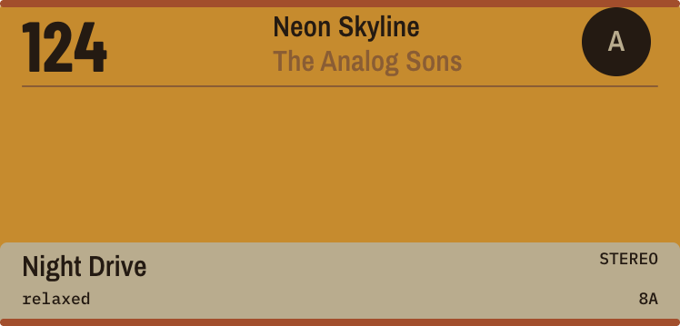

# Design prompts for K7 labels

A label brief is two things: the look, in words, and the fields the player fills. The mechanics
— the print's box, the Card's window, the caps — are the
[agent skill](../skills/k7-labels/SKILL.md)'s, and the editor enforces them. This page is the
taste half: what makes a design read as a cassette label rather than a form, and seven prompts
you can paste at an agent that has the page open.

## What makes a cassette label read as one

The four things every label in a real collection does, and the three built here do:

1. **A field of one saturated colour, not white.** Warm pigments — mustard, terracotta,
   avocado, steel blue, cream — with **one surprising accent** (magenta, orange, cyan) used
   once, as an edge or a word.
2. **A hero.** One big thing at 78 px, usually the side's number: a tape's `C-90`, a drum
   machine's `808`. Here it is the track's **BPM**, so the label works for every tape.
3. **A side badge.** `A` or `B` in a filled circle, top right, 76 px across — the one
   element that says "this is the side you are holding".
4. **Small mono print.** Captions in the third face (`STEREO`, `SIDE A`, the key, the mood),
   set small on a bar or a row, never competing with the hero. The small things sell it: a
   2 px rule under the top strip, one or two **edge lines in the accent colour**.

Two constraints shape everything. **The Card's window is a hole** at (95,101) 556 × 166 r83:
the label is a frame, so the composition lives in the strip above it and the strip below it,
and the middle is left to the tape. And **the sheet draws filled rects, circles and text
only** — no images, no strokes, no gradients. That frugality is what makes it look printed
instead of decorated; lean on colour fields and type, not effects.

## The sleeve devices

The J-card grid in a good collection is mostly one of six moves, and every one of them is
built from filled shapes and the three faces:

| Device | The editor's moves | Seen on |
|---|---|---|
| Overlapping discs | circles printed one over another, one per band colour | STANDARD C-60 |
| Dot grid | rows of 6–10 px circles in a band colour | VOICE |
| Concentric rings | a band circle, a paper-coloured circle over it, repeat | SUNEL |
| Barcode | 15–20 thin rects of alternating widths along a bar | maxell LN |
| Rule stack | 1–2 px rects every 10 px, with type printed over them | FUJIFILM FL 60 |
| Giant numeral, bled | a 78 px numeral placed so the print crops it — at a negative x, or past the edge | Kobenica 60, FL 60 |

A wordmark is the seventh: a static text at 78 px as the brand line.

## The shape of a prompt

Five parts, in this order, then the deliverable:

> Make a K7 cassette label in the style of **[a 1970s HiFi Ferro tape]**. The field is
> **paper `#…` with `#…` ink**, the accent is **`#…`**. The hero is **<field>** at 78 px, top
> left; the side letter **[A|B]** sits in a solid circle top right. Below the window, a **`#…`**
> bar carries **<field>** in the title face and the small print as captions: **<field>**,
> **`STEREO`**, **<field>**. Template id **`label.…`**. Export the JSON.

Everything else — the coordinates, the type roles, the window — the agent takes from its guide,
so leave them out unless you want them exact. The prompts below give the coordinates because
they are the two designs that were built and checked; copy them when you want that label, or
use them as a shape for your own.

## The prompts

### 1. Mustard and ink — "HiFi 1969"

> Make a K7 cassette label in the style of a 1970s HiFi Ferro tape. Mustard field
> (#c68b2e), deep brown ink (#241a12), terracotta accent (#a24e2c). The hero is the BPM at
> 78 px, top left, ink. The title is ink at 32 px beside it, the artist under it in #8a5d34.
> The side letter A sits in a solid ink circle at (640,8) 76 × 76, the letter in #b9ac8e. A
> 2 px #8a5d34 rule runs under the top strip at y 94. Below the window, a #b9ac8e bar from
> y 267 to 359 carries the album at 32 px, the mood as a caption under it, and STEREO and the
> musical key as right-aligned captions. An 8 px #a24e2c line frames the top and the bottom.
> Paper #c68b2e, radius 10. Template id label.hifi-1969. Export the JSON.

### 2. Navy, magenta and pinstripes — "808 Stripes"

> Make a K7 cassette label in the style of an 808 drum machine tape: deep navy (#1b3a63),
> cream ink (#f2ecdf), magenta accent (#c23b66). The hero is the BPM at 78 px top left, in
> magenta. The side letter B sits in a solid magenta circle at (640,8) 76 × 76, the letter in
> cream (#f2ecdf). The title is cream at 32 px beside the hero, the artist steel blue (#3b6e8f) under
> it. Three 2 px pinstripes in magenta and orange cross the print at y 150, 190 and 230 — the
> Card's window hides their middle, so they read as ticks in the side margins — and a 5 px
> magenta line closes the window's bottom edge at y 262. Below it, the album in cream at
> 32 px, the mood in mustard as a caption, STEREO in magenta and the key in cream, right
> aligned. An 8 px magenta line frames the bottom. Paper #1b3a63, radius 10. Template id
> label.808-stripes. Export the JSON.

### 3. Overlapping discs — "Discs C-60"

> Make a K7 cassette label in the style of a 1970s sleeve like the STANDARD C-60: cream field
> (#f5f1e6), dark ink (#241a12), orange, mustard and sand discs. Three 94 px circles, printed
> one over the last, sit in the top strip at (18,4), (78,4) and (138,4), in #df7b35, #c68b2e
> and #c7a867. The title is ink at 32 px at (272,12), the artist a caption under it. The hero
> is the BPM at 78 px, top right, right-aligned to 724. A 2 px orange rule runs under the
> strip at y 94. Below the window, a sand bar (#c7a867) carries the genre at 32 px, the mood
> as a caption, C-60 and the key as right-aligned captions. A 4 px orange line frames the
> bottom. Paper #f5f1e6, radius 6, template id label.discs-c60.

### 4. Dot grid and a wordmark — "Voice"

> Make a K7 cassette label like a 1980s VOICE sleeve: brown field (#8a5d34), cream ink
> (#f5f1e6). In the top strip's left half, a grid of cream 8 px circles — 6 columns × 4 rows at
> 22 px spacing from (24,12). Over the grid, a static wordmark `VOICE` at 78 px in cream, and
> to its right the title at 32 px and the artist as a caption. The side letter A sits in a
> cream circle top right, the letter in #8a5d34. Below the window, cream rules and the album,
> mood and key as captions. Paper #8a5d34, radius 8, template id label.voice.

### 5. Concentric rings — "Sunel"

> Make a K7 cassette label like the SUNEL C-60: deep blue field (#1b3a63), cream ink
> (#f5f1e6). In the top strip's left, a target of concentric rings: a 92 px cream circle at
> (24,4), a 62 px blue circle over it, a 34 px cream circle over that, and a 16 px blue one in
> the middle. The title is cream at 32 px to its right; the hero is the BPM at 78 px,
> right-aligned top right. Below the window, a cream rule at y 267 and the album, mood and key
> as captions, a cream rule closing the bottom. Paper #1b3a63, radius 8, template id
> label.sunel-rings.

### 6. Sunflower — "C-60"

> Make a K7 cassette label like a 1970s C-60 sleeve: burnt orange field (#df7b35) with dark
> ink (#241a12). A cream (#f5f1e6) bar across the top strip carries the title at 32 px, with
> the artist under it as a caption. The hero is a static `C-60` at 78 px, top right, in dark
> ink — the tape, not the track. A cream badge with the side letter sits behind it, and the
> bottom strip carries the album, STEREO and the key on cream. Paper #df7b35, radius 12,
> template id label.sunflower-c60.

### 7. Avocado grid — "Graph C90"

> Make a K7 cassette label like a green graph-paper C-90: avocado field (#6b7a2f), dark ink
> (#241a12), one red (#c23b66) accent. Draw the graph with eight 1 px ink rules: five
> horizontal across the top strip and three vertical down the left margin, so the type sits
> in the grid. The hero is the BPM at 78 px, top left, over the rules; the side letter A in a
> red circle top right. The bottom strip is paper-coloured with the album at 32 px and the
> small print as captions. Paper #6b7a2f, radius 6, template id label.graph-c90.

## What not to ask for

- **A photo, a texture, a gradient, a shadow, an outline or a custom font.** The sheet draws
  filled rects and circles, and three faces at 32, 78 and 18 px; anything else the editor will
  refuse or approximate badly.
- **A second colour on one text.** A text prints in the ink or in one of the bands, never on
  the paper.
- **Anything important in the window.** It is a hole; the tape shows through it.
- **More than you need.** The sheet holds 48 layers, 16 fields and up to 8 band colours per
  design; the three built prompts above use 14, 15 and 14 layers — the dot grid prompts will
  need about 28 because every dot is a layer.

## The built ones

Prompts 1, 2 and 3 were built with the editor's own tools, through the bridge, and exported
with no errors (14, 15 and 14 prims; `label.hifi-1969`, `label.808-stripes` and
`label.discs-c60`). The pictures are the print at 748 × 359, which is the size the panel
draws. They were built in a scratch browser session, so they are not in
`assets/labels/templates/` — build one from its prompt, then Export it there. Their middles
are quiet on purpose: on the device that is the Card's window, and the tape is what shows
there.
