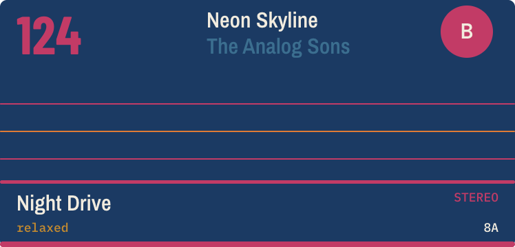
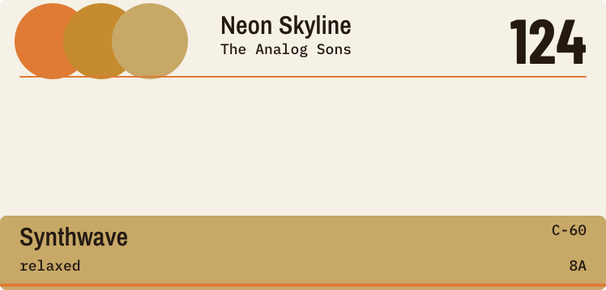

# Design prompts for K7 labels

A K7Art is two designs on one file: the label, whose brief is the look in words and the fields
the player fills, and the J-card, whose one sheet shares the palette and the faces. The
mechanics — the print's box, the Card's window, the J-card's sheet and panels, the caps — are
the [agent skill](../skills/k7-art/SKILL.md)'s, and the editor enforces them. This page is the
taste half: what makes a design read as a cassette sleeve rather than a form, seven prompts you
can paste at an agent that has the page open, and the pack that carries the finished pair to
the K7.

## What makes a cassette label read as one

The four things every label in a real collection does, and the three built here do:

1. **A field of one saturated colour, not white.** Warm pigments — mustard, terracotta,
   avocado, steel blue, cream — with **one surprising accent** (magenta, orange, cyan) used
   once, as an edge or a word.
2. **A hero.** One big thing at 78 px, usually the side's number: a tape's `C-90`, a drum
   machine's `808`. Here it is the track's **BPM**, so the label works for every tape.
3. **A side badge.** `A` or `B` in a filled circle, top right, 76 px across — the one
   element that says "this is the side you are holding".
4. **Small mono print.** Captions in the third face (`STEREO`, `SIDE A`, the key, the mood),
   set small on a bar or a row, never competing with the hero. The small things sell it: a
   2 px rule under the top strip, one or two **edge lines in the accent colour**.

Two constraints shape everything. **The Card's window is a hole** at (95,101) 556 × 166 r83:
the label is a frame, so the composition lives in the strip above it and the strip below it,
and the middle is left to the tape. And **the sheet draws filled rects, circles and text
only** — no images, no strokes, no gradients. That frugality is what makes it look printed
instead of decorated; lean on colour fields and type, not effects.

## The sleeve devices

A sleeve in a good collection is mostly one of six moves, and every one of them is
built from filled shapes and the three faces:

| Device | The editor's moves | Seen on |
|---|---|---|
| Overlapping discs | circles printed one over another, one per band colour | STANDARD C-60 |
| Dot grid | rows of 6–10 px circles in a band colour | VOICE |
| Concentric rings | a band circle, a paper-coloured circle over it, repeat | SUNEL |
| Barcode | 15–20 thin rects of alternating widths along a bar | maxell LN |
| Rule stack | 1–2 px rects every 10 px, with type printed over them | FUJIFILM FL 60 |
| Giant numeral, bled | a 78 px numeral placed so the print crops it — at a negative x, or past the edge | Kobenica 60, FL 60 |

A wordmark is the seventh: a static text at 78 px as the brand line.

## The J-card, on the same sheet

Every K7Art carries a **J-card** beside its label, and the pair shares the paper, the ink, the
rule, the eight bands and the three faces. The J-card is one printed side of a cassette case,
drawn as **1300 × 1280 units at 320 units per inch** — 4.0625 × 4 in — scored into three
panels:

| Panel | x | What the App does with it |
|---|---|---|
| Flap | 0…320 (1 in) | nothing yet: authored and exported, with no surface to draw it on |
| Spine | 320…480 (0.5 in) | the shelf's left face |
| Cover | 480…1300 (2.5625 in) | the case front and the album card |

The folds are guides, not clipping: art may cross them, and the editor draws them at x = 320
and x = 480. Its texts bind to three **J-card fields**, not the label's fields: `title` is the
album's name, `artist` the byline (one artist, or "N artists" for a compilation), and `meta`
the line the App passes — `Side A · Side B` by default, the album's name on a Track's case.
The three faces keep their roles but take the J-card's own sizes; the defaults are `title` 56,
`numeral` 136 and `caption` 31 units.

The webapp draws the cover part on the case front and the album card, and the spine part on
the shelf's left face. The album card is square and centre-cropped, so the cover's **safe
square** is its central 820 × 820 — x 480…1300, y 230…1050 — and the words belong inside it;
the rest is the case's portrait face. One printed side: no back, no tracklist and no print
export. A real cover picture still wins.

## The shape of a prompt

Five parts, in this order, then the deliverable:

> Make a K7 cassette label in the style of **[a 1970s HiFi Ferro tape]**. The field is
> **paper `#…` with `#…` ink**, the accent is **`#…`**. The hero is **<field>** at 78 px, top
> left; the side letter **[A|B]** sits in a solid circle top right. Below the window, a **`#…`**
> bar carries **<field>** in the title face and the small print as captions: **<field>**,
> **`STEREO`**, **<field>**. Template id **`k7.…`**. Export the K7Art.

Everything else — the coordinates, the type roles, the window — the agent takes from its guide,
so leave them out unless you want them exact. Every prompt makes a K7Art, so its J-card is part
of the design: the editor starts one from the paper and the three fields, and a line can name
what the cover carries. The prompts below describe the label; the pair is exported together.
The prompts give coordinates because they are the designs that were built and checked; copy them
when you want that label, or use them as a shape for your own.

## The prompts

### 1. Mustard and ink — "HiFi 1969"

> Make a K7 cassette label in the style of a 1970s HiFi Ferro tape. Mustard field
> (#c68b2e), deep brown ink (#241a12), terracotta accent (#a24e2c). The hero is the BPM at
> 78 px, top left, ink. The title is ink at 32 px beside it, the artist under it in #8a5d34.
> The side letter A sits in a solid ink circle at (640,8) 76 × 76, the letter in #b9ac8e. A
> 2 px #8a5d34 rule runs under the top strip at y 94. Below the window, a #b9ac8e bar from
> y 267 to 359 carries the album at 32 px, the mood as a caption under it, and STEREO and the
> musical key as right-aligned captions. An 8 px #a24e2c line frames the top and the bottom.
> Paper #c68b2e, radius 10. Template id k7.hifi-1969. Export the K7Art.

### 2. Navy, magenta and pinstripes — "808 Stripes"

> Make a K7 cassette label in the style of an 808 drum machine tape: deep navy (#1b3a63),
> cream ink (#f2ecdf), magenta accent (#c23b66). The hero is the BPM at 78 px top left, in
> magenta. The side letter B sits in a solid magenta circle at (640,8) 76 × 76, the letter in
> cream (#f2ecdf). The title is cream at 32 px beside the hero, the artist steel blue (#3b6e8f) under
> it. Three 2 px pinstripes in magenta and orange cross the print at y 150, 190 and 230 — the
> Card's window hides their middle, so they read as ticks in the side margins — and a 5 px
> magenta line closes the window's bottom edge at y 262. Below it, the album in cream at
> 32 px, the mood in mustard as a caption, STEREO in magenta and the key in cream, right
> aligned. An 8 px magenta line frames the bottom. Paper #1b3a63, radius 10. Template id
> k7.808-stripes. Export the K7Art.

### 3. Overlapping discs — "Discs C-60"

> Make a K7 cassette label in the style of a 1970s sleeve like the STANDARD C-60: cream field
> (#f5f1e6), dark ink (#241a12), orange, mustard and sand discs. Three 94 px circles, printed
> one over the last, sit in the top strip at (18,4), (78,4) and (138,4), in #df7b35, #c68b2e
> and #c7a867. The title is ink at 32 px at (272,12), the artist a caption under it. The hero
> is the BPM at 78 px, top right, right-aligned to 724. A 2 px orange rule runs under the
> strip at y 94. Below the window, a sand bar (#c7a867) carries the genre at 32 px, the mood
> as a caption, C-60 and the key as right-aligned captions. A 4 px orange line frames the
> bottom. Paper #f5f1e6, radius 6, template id k7.discs-c60. Export the K7Art.

### 4. Dot grid and a wordmark — "Voice"

> Make a K7 cassette label like a 1980s VOICE sleeve: brown field (#8a5d34), cream ink
> (#f5f1e6). In the top strip's left half, a grid of cream 8 px circles — 6 columns × 4 rows at
> 22 px spacing from (24,12). Over the grid, a static wordmark `VOICE` at 78 px in cream, and
> to its right the title at 32 px and the artist as a caption. The side letter A sits in a
> cream circle top right, the letter in #8a5d34. Below the window, cream rules and the album,
> mood and key as captions. Paper #8a5d34, radius 8, template id k7.voice. Export the K7Art.

### 5. Concentric rings — "Sunel"

> Make a K7 cassette label like the SUNEL C-60: deep blue field (#1b3a63), cream ink
> (#f5f1e6). In the top strip's left, a target of concentric rings: a 92 px cream circle at
> (24,4), a 62 px blue circle over it, a 34 px cream circle over that, and a 16 px blue one in
> the middle. The title is cream at 32 px to its right; the hero is the BPM at 78 px,
> right-aligned top right. Below the window, a cream rule at y 267 and the album, mood and key
> as captions, a cream rule closing the bottom. Paper #1b3a63, radius 8, template id
> k7.sunel-rings. Export the K7Art.

### 6. Sunflower — "C-60"

> Make a K7 cassette label like a 1970s C-60 sleeve: burnt orange field (#df7b35) with dark
> ink (#241a12). A cream (#f5f1e6) bar across the top strip carries the title at 32 px, with
> the artist under it as a caption. The hero is a static `C-60` at 78 px, top right, in dark
> ink — the tape, not the track. A cream badge with the side letter sits behind it, and the
> bottom strip carries the album, STEREO and the key on cream. Paper #df7b35, radius 12,
> template id k7.sunflower-c60. Export the K7Art.

### 7. Avocado grid — "Graph C90"

> Make a K7 cassette label like a green graph-paper C-90: avocado field (#6b7a2f), dark ink
> (#241a12), one red (#c23b66) accent. Draw the graph with eight 1 px ink rules: five
> horizontal across the top strip and three vertical down the left margin, so the type sits
> in the grid. The hero is the BPM at 78 px, top left, over the rules; the side letter A in a
> red circle top right. The bottom strip is paper-coloured with the album at 32 px and the
> small print as captions. Paper #6b7a2f, radius 6, template id k7.graph-c90. Export the K7Art.

## What not to ask for

- **A photo, a texture, a gradient, a shadow, an outline or a custom font.** The sheet draws
  filled rects and circles, and the label's three face-and-size pairs (32, 78 and 18 px); the
  J-card has the same three faces at its own sizes. Anything else the editor will refuse or
  approximate badly.
- **A second colour on one text.** A text prints in the ink or in one of the bands, never on
  the paper.
- **Anything important in the window.** It is a hole; the tape shows through it. On the J-card,
  keep the words inside the cover's safe square rather than treating the whole sheet as the
  front.
- **More than you need.** The sheet holds 48 layers, 16 Slots and up to 8 band colours per
  design; the three built prompts above use 14, 15 and 14 layers — the dot grid prompts will
  need about 28 because every dot is a layer.

## The built ones

Prompts 1, 2 and 3 were built with the editor's own tools, through the bridge, and exported
with no errors (14, 15 and 14 prims; `k7.hifi-1969`, `k7.808-stripes` and
`k7.discs-c60`). The pictures are the label's print at 748 × 359, which is the size the panel
draws. They were built in a scratch browser session, so they are not in `assets/k7art/` — build
one from its prompt, then Export it there. Their middles are quiet on purpose: on the device
that is the Card's window, and the tape is what shows there. Each export is a K7Art, so give
its J-card the design's paper and its three fields.

## The pack

A design that leaves the editor by **Export** is the factory road: the file goes in
`assets/k7art/`, and the build packs its label section into the K7's sheet and bundles its
J-card into the App. **Publish** is the user's road: it takes any subset of the open K7Arts, a
pack id, a name and an author, and writes one `.k7artpack` as a download — the binary label
sheet built in the browser, the designs' J-card sections and a header
([`docs/specs/art-packs.md`](../../../docs/specs/art-packs.md)).

The file is installed by the App, not the editor: **Settings → Art packs** imports it, shows
its designs and their J-cards, uploads it to the K7's `POST /api/art`, and caches its J-cards
for the covers. One **User pack** is active at a time and it is additive — its designs join the
factory's in one pool, factory first — and **Reset to factory** removes it. The editor never
reaches the device; a pack is art in flash, not a Track.
