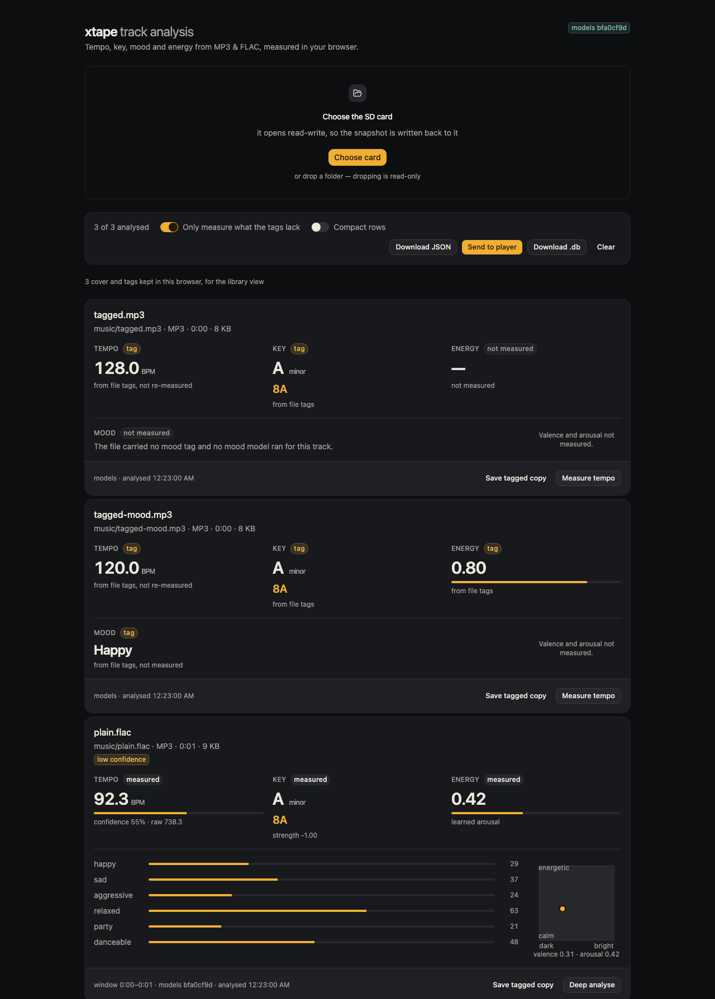
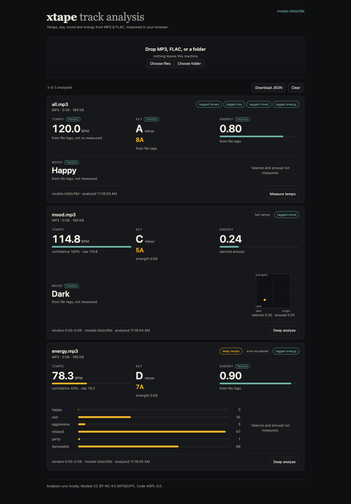

# xtape track analysis

A browser-only webapp that measures **tempo, key, mood and energy** for MP3 and FLAC files.
Files never leave the machine: decode, analysis, caching and export all happen in the tab.



This is the implementation of
[`docs/research/bpm-key-mood-energy-webapp.md`](../docs/research/bpm-key-mood-energy-webapp.md).

## What it reports

- **Tempo** — folded into 70–180 BPM, with the detector's raw value and a confidence score.
  Fast analysis uses Degara and escalates automatically to the accurate multifeature tracker
  when confidence is low. If the file already has a `TBPM`/`BPM` tag, that value is used,
  marked **tagged**, and tempo analysis is skipped.
- **Key** — tonic and mode, the Camelot code, and the detector's correlation strength. A
  `TKEY`/`key`/`initialKey` tag that parses as Camelot (`8A`) or a note name (`Am`,
  `F#m`) is used and marked **tagged**; anything it cannot parse is measured instead.
- **Mood** — six probabilities from Essentia's EffNet heads: happy, sad, aggressive,
  relaxed, party, danceable.
- **Valence / arousal** — 0–1 regressions from the DEAM model. **Energy is arousal**, not a
  separate measurement.
- **Mood and energy tags** — a `TMOO`/`MOOD` tag becomes a tagged mood label (the six model
  probabilities are skipped); an `ENERGY`/`TXXX:ENERGY` tag (0–1, 0–100 or `%`) becomes tagged
  energy (DEAM is skipped). Valence/arousal are only present when DEAM ran, so a tagged energy
  with a measured mood shows the bars without the V/A plot.



Results are read-only and are cached in IndexedDB by content hash, analyzer version and model
set. `Download JSON` exports the analyses with provenance.

## Quick start

```sh
cd web
npm install
npm run models     # ~24 MB of ONNX weights, checksum-pinned, gitignored
npm run dev
```

Then open the printed URL, drop files or a folder, and wait for the cards.
`dev` also copies ONNX Runtime's WASM loader into `public/ort/`.

`npm run models` fetches from `essentia.upf.edu` and verifies every SHA-256 against
`weights.lock.json`; a mismatch fails the command rather than loading different weights.
> If `npm` on this machine cannot write `~/.npm` (a permissions issue seen during
> development), add `--cache .npm-cache` to the install command. That directory is ignored.

## Scripts

| Command | What it does |
|---|---|
| `npm run dev` | Vite dev server with cross-origin isolation headers |
| `npm run build` | Typechecks and builds the local app into `dist/` |
| `npm run preview` | Serves the production build with the same headers |
| `npm test` | Vitest: domain logic, mel parity, real-model pipeline |
| `npm run models` | Fetches and verifies the ONNX model set |
| `npm run assets` | Copies the local runtime files to `public/ort/` and `public/weights/` |
| `npm run icons` | Regenerates the 192 and 512 PNG icons |

## How it works

1. A dropped folder is walked with `webkitGetAsEntry` (or the folder picker's
   `webkitRelativePath`) and every MP3/FLAC found is queued with its relative path.
2. The main thread hashes the file and checks the IndexedDB cache.
3. On a miss it reads embedded tags with `music-metadata`. Each tagged field skips its own
   model: BPM, key, mood (EffNet heads) and energy (DEAM). If both BPM and key are tagged the
   44.1 kHz decode is skipped; if mood and energy are tagged too, no model runs at all.
4. Decoding uses `OfflineAudioContext` once: mono 44.1 kHz for tempo/key, resampled in memory
   to 16 kHz for the models. Duration comes from the decoded samples, so MP3 encoder padding
   is handled.
5. An analysis worker pool runs one track per worker, so the queue keeps the cores busy. Its
   size is auto-detected at boot — half the logical cores, capped by the memory the browser
   reports, then checked by starting that many — and can be pinned in Settings. A worker runs
   Essentia.js (WASM) for Degara beats and `KeyExtractor` (when they are not tagged).
   The multifeature tracker is not automatic any more: it costs 3.6 s against 0.67 s for the
   two, so it runs only when the user asks, and `tempo.suggestEscalation` says when that is
   worth doing.
6. Mood uses a 30 s window starting a quarter of the way in, and tempo/key use 120 s from
   the same point — the whole track is decoded, but only the excerpt is analysed, because an
   Essentia pass over a ten-minute file is what made a run take minutes. The log-mel front-end is
   implemented in TypeScript (`src/audio/mel.ts`) and verified against Essentia's WASM
   implementation in `tests/mel.test.ts` (max band difference ≈3e-5). EffNet supplies the six
   tag heads when mood is not tagged; MusiCNN supplies the DEAM valence/arousal head when
   energy is not tagged.
7. Results are cached by `sha256(file) : analyzer version : model set` and exported as JSON.
   Tagged fields carry `source: "metadata"` and a null confidence/strength; measured fields
   carry `source: "measured"`.
8. `taglib-wasm` loads on demand to write the standard fields — BPM, key, mood, energy — and
   the `XTAPE` manifest. A card opened read-write gets them in place as each track settles, so
   the next run reads them and skips the models; a dropped folder is read-only, so its row
   menu writes a tagged copy instead. `XTAPE` takes precedence over the standard tags on the
   next analysis.
9. That same write puts the player's picture of the Track in the file: **k7label**, a
   402x188 JPEG (the print on the white page's Card) fitted cover-style from the Track's own
   art and passed through the worn-print shader (`src/audio/covers.ts`, `src/audio/worn.ts`).
   A card opened read-write gets both the tags and the label in place as each Track settles; a
   dropped folder can only get them in the saved copy. A finalize records the writer's version
   on the Track's media row (`METADATA_WRITE_VERSION`), so the next scan opens a file only when
   that record is absent or older than the build: a settled card is recognised in milliseconds
   and a reload does not draw or rewrite it again. A changed filter, tag set or encoder is a
   new version, which is one pass that rewrites every measured file.
   Pictures change a file's size and hash, so the row and the analysis are re-keyed to the
   bytes the card now holds. The 426x272 cassette picture is not written at the moment; a
   file that carries one from an earlier build keeps it, and it is never used as art.

The worker loads ONNX Runtime's WASM loader from `public/ort/` by absolute URL, so Vite
never treats it as a source import (public files cannot be imported from source in dev); the
models come from `public/models/`. The dev and preview servers set COOP/COEP so ORT can use
multiple threads; without those headers it falls back to one thread.

### The device page

There is none. [ADR 0067](../docs/adr/0067-chrome-only-direct-to-the-device.md) removed the
Launcher and the Shell: the device serves no page, packs no image, and `/` answers 404. The App
reaches the device directly once the `local-network` permission is granted — `src/device/local.ts`,
read and gated by `src/ui/LocalNetworkGate.tsx`.

Everything else is a **weight**, loaded through `src/weights/`:

1. `weights.lock.json` (imported into the app) lists every file, its URL source and its
   sha256. The models are fetched from the repository at the pinned tag; Essentia, ONNX
   Runtime and TagLib come from jsDelivr at their published versions.
   The models are committed at `web/public/models/` precisely because that tag's tree is the
   CDN's source; `npm run models` re-fetches them, and a release tag cut from a tree without
   them would make the first analysis fail the hash check, which is the correct failure.
2. A weight is fetched, hashed and only then handed to its runtime. A mismatch is refused
   and named. Essentia's JavaScript is imported from a blob URL after the check.
3. Verified bytes are cached in IndexedDB by URL and hash, and the service worker keeps a
   second cache under a name carrying the app version and the manifest hash.

`npm run dev` and `npm run build` use the same code with `WEIGHTS_MODE=local`: the weights
come from `public/models/`, `public/ort/` and `public/weights/`, so development needs no
network. A local build that has not run `npm run models` says so instead of analysing.

## The interface

The page is React 19 on Vite, styled with Tailwind CSS v4 and built from shadcn/ui. The
component style is `base-nova` (Base UI primitives) and `components.json` points the shadcn
CLI at the ReUI registry, so components are installed rather than written:

```sh
npx shadcn@latest add card button progress switch empty spinner   # shadcn/ui
npx shadcn@latest add @reui/badge @reui/alert @reui/c-sidebar-1   # ReUI
```

- **One shell, four areas** — Card (Prepare), Playlists (Manage, Ask), Media, Player —
  adapted from the `c-sidebar-1` example: its workspace switcher is the device, its count
  badges carry the track count and the draft count, and its account menu is gone (there are
  no accounts). Settings and the licence sit in the sidebar footer.
- **Routes are hashes** (`#/prepare`, `#/playlists/:id`, `#/media/video/:id`) so the device
  still serves one page and answers 404 for everything it does not know. The card state
  chooses the first area once; `src/ui/router.ts` is the whole router and it has no
  dependency.
- **Prepare stays mounted** while another route is shown, and that is what protects a running
  queue: `App.tsx` hides it rather than unmounting it.
- `src/index.css` is the only stylesheet: Tailwind, the theme tokens, the two `@font-face`
  rules for the self-hosted **Jura** (the face the device draws with), and nothing else. The
  palette is the app's own — warm charcoal, an amber accent and a teal "measured" — mapped
  onto semantic tokens so the components keep their identity. The page is dark only:
  `index.html` carries `class="dark"`.
- `src/components/ui/` and `src/components/reui/` are installed code. Do not edit them to
  restyle; change the tokens in `src/index.css`, or the `variant` and `size` a call site
  passes. `src/components/examples/c-sidebar-1.tsx` is the installed example, kept as the
  reference the shell was adapted from; nothing imports it.
- `src/ui/` is ours: the shell, the eleven area files, and the pieces they use. A panel is a
  `Card`, a state is a `Badge` variant, a meter is `Progress`, a missing thing is an `Empty`
  with one action.
- **Data**: `src/ui/state/analysis.tsx` owns the measuring queue and the image it builds;
  `src/playlists/drafts.ts` owns the browser's drafts; `src/device/` is the device (a shared
  status poller, `/api/playlists`, and a small MCP client); `src/media/` is the covers cache
  index and the Invidious search; `src/audio/covers.ts` is the label a file carries for the
  player's screen, and `src/audio/worn.ts` the shader that wears it; `src/settings.ts` is
  what this browser remembers for itself.
- The Shell is packed into a 1.25 MB flash partition (`partitions.csv`) as one image, which
  the board copies into PSRAM at boot.
  Measured: **377 KiB of bytes** (381 KiB of image), up from ~350 KiB before the sidebar — the sidebar, its
  dropdown menu, breadcrumb and avatar parts are most of the difference. Page code costs
  flash, not disk: a single `AlertDialog` is ~56 KiB of JavaScript, which is why the
  destructive confirm is asked in place. Weigh a new dependency as a budget decision.

## The assistant

Ask is a conversation. One sentence goes to Chrome's **built-in model** (Gemini Nano), which
returns filters; the App runs them and answers with the tracks it found. There is no key, no
endpoint and no setting: the model runs on this machine, the sentence is not sent anywhere, and
once the model is downloaded Ask works offline.
[ADR 0084](../docs/adr/0084-the-assistant-is-the-browsers-built-in-model.md) records the move from the
remote Provider, and [ADR 0086](../docs/adr/0086-the-assistant-is-a-conversation.md) the conversation.

The model writes filters, never results. Every word in Ask's answer — the count, what it
understood, the library it came from, the offer to save — is computed by the App from the filters
that ran and the search that answered.

### What it needs

Chrome 148 or later on a computer — Windows 10 or 11, macOS 13+, Linux, or ChromeOS on a
Chromebook Plus. Not Chrome for Android, iOS, or a ChromeOS device that is not a Plus. The machine
needs at least 22 GB free on the volume that holds the Chrome profile, and either a graphics card
with more than 4 GB of VRAM or 16 GB of RAM with four CPU cores. The first use downloads the
model, a few gigabytes, on an unmetered connection; after that no network is used.

Chrome keeps the model until free space falls below 10 GB, then removes it and downloads it again
when there is room. Ask re-checks at each visit, so the state it shows is the state now.

Ask says which of these is missing, and the **Filters** sheet below still searches without any
of it.

### The download

The model is Chrome's, not the app's. Ask can start the download and show its progress; it cannot
cancel or delete the model, and the model is not part of the app's 41 MB of weights.
`chrome://on-device-internals` shows its size and state in Chrome, and removal is in Chrome's
settings.

The download needs a click, because Chrome requires user activation; that is what **Set up the
assistant** is.

### The answer

The composer is at the foot of the page. Say what you want and press Enter: your sentence becomes a
message, and the answer names what was understood ("Found 10 tracks — techno, 124–132 BPM"), the
library it came from, and the tracks. Four are shown; **Show all N tracks** expands the list.

**Filters** opens the exact `library_search` arguments, already filled from your sentence. Change
one and **Run search** without asking the model again. The same sheet is the search for a machine
without the built-in model.

When the answer comes from a card this browser holds, Ask asks whether to save the tracks as a
playlist **on this card**. Saving makes a draft in Playlists; it does not write the card or the
player, and **Prepare** is where a draft is sent. The player's card is read-only from here, so its
answer says a playlist needs the card in the computer.

Each ask stands alone: the previous sentence and its filters are not sent back to the model, so
"make it faster" is a new ask rather than a change to the last set. The conversation is not
stored; a reload clears it. Drafts survive.

### The languages

Chrome documents English, Japanese, Spanish, German and French for the model. The sentence can be
in any of them; the Intent's values — mood names, sort names, keys — are the same in all.

### What a filter sees

Every filter is `library_search`'s own argument, and each measurement it names is a field the
Snapshot row carries. A range only sees tracks that were measured: a track with no row still
matches a name search, and an unknown measurement never matches a range. BPM is the folded tempo,
70–180, so a bound outside it cannot match; a track's length is seconds, so "under three minutes"
is a `duration_max` of 180. A length of the *tracks* is a filter; a length of the *listening
session* ("two hours of…") is a row count, not a length bound. The Player reports coverage.

A filter the library has no values for — a genre nobody tagged, a key nobody measured — returns an
empty result, not an error. The answer's reading names the filters that ran, and **Filters** opens
the same arguments.

### The library's own values

Ask searches the player when the **Device card** tile is selected, or when the player holds the
selected card; the card's **Last image** otherwise, so a virtual card is always the image. The
results say which one answered, and for the player, how many of its tracks are analysed.

When Ask has a library to describe, it tells the model that library's aggregates: its genres, its track count, and the range and quartiles of BPM, energy,
danceability, valence, arousal and track length. The model then cannot offer a genre the library
does not have or a BPM or length range no track can fall in; the schema is closed to the same
values, and the WORD→FILTER thresholds are the library's own quartiles.

Genres are capped at the 40 most common; a library with more leaves its rarest out of the list
and the enum. It is aggregates only — no track, artist, path or per-track measurement — and the
model is the local one. When the player is running another image, or there is none, the static ranges apply.

### What the model is not

It writes filters, never results: it never sees a title, an artist, a path, a measurement or the
library's size (ADR 0053, ADR 0084). It is a small model. On the twelve-sentence spike it got ten
right and all twelve schema-valid; it turned "an hour" into 75 rows instead of 15 and lost the
artist in "songs by Daft Punk", and it sometimes puts a category in `query` and adds ranges the
sentence did not ask for. When the word is not a name the sentence used — a category, a purpose
like "for a workout", or a lowercase word with no name before it — Ask asks once more with your
sentence and drops it if it persists. A tightened prompt was measured on the same rubric and
scored lower (eight of twelve), so the shipped prompt is the one above. The answer says what it
understood and **Filters** opens the exact filters, so a wrong one is an edit rather than a wrong
playlist — seen after the first result, not before it. The answer's words are the App's for the
same reason: the model never sees a track, so it cannot describe one.

## Accuracy caveats

These are measurements, not ground truth for your library:

- Tagged BPM, key, mood and energy are trusted as-is; they can be wrong. The UI marks each
  tagged field. `Measure tempo` re-runs the accurate tracker, replacing a tagged BPM for that
  result; other tagged fields are only re-measured by changing the file's tags.
- Tempo confidence is a heuristic (fraction of beat intervals within ±5 % of the median), not
  a calibrated probability. Half/double tempo is normal; the folded value and raw value are
  both reported.
- Key detection is the weakest field. MIREX-class systems reach roughly 60–70 % on EDM, and
  Essentia publishes no accuracy figure for `KeyExtractor`. Treat the strength as a hint.
- Mood models lose 10–30 points when transferred to a different collection (e.g. happy 0.86
  cross-validation → 0.71 on MTG-Jamendo). The bars are probabilities, not labels.
- The app was smoke-tested with synthetic audio for pipeline correctness, not musical
  accuracy. See the research note for the source measurements.

## Limitations in v0.1

- MP3 and FLAC only; no server, no editing, no beat grid. Folder scans are sequential, so a
  large library takes minutes.
- Saving produces a download, not an in-place update; and saving one card at a time is the
  only batch story for now.
- One 30 s mood window and one 120 s tempo/key window; shorter tracks use all of it.
- Local use only. `SOURCE_URL` in `src/config.ts` must be set before deploying publicly, so
  the AGPL source offer is reachable.
- Browser support is Chromium/Firefox-first (FLAC in `decodeAudioData` varies in Safari).

## Licence

- The app code is **AGPL-3.0**; see [`LICENSE`](./LICENSE).
- The ONNX weights are **CC BY-NC 4.0**, by the Music Technology Group (UPF), and are
  committed to this repository at `web/public/models/` because jsDelivr serves them from the
  pinned tag's tree. They remain under their own licence; the combined application is
  therefore **non-commercial**. Commercial use needs a proprietary licence from MTG.
- Model provenance and citations are in [`NOTICE`](./NOTICE).

The domain glossary for this context is [`CONTEXT.md`](./CONTEXT.md).
