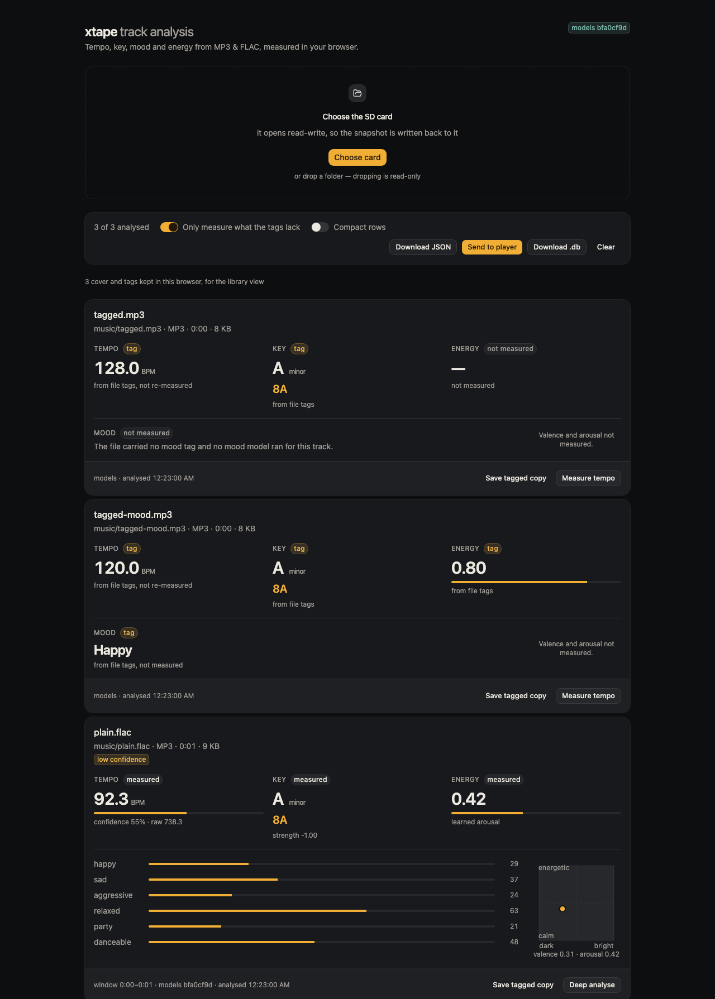
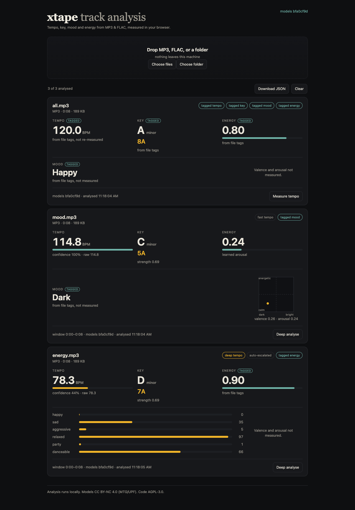

# xtape track analysis

A browser-only webapp that measures **tempo, key, mood and energy** for MP3 and FLAC files.
Files never leave the machine: decode, analysis, caching and export all happen in the tab.



This is the implementation of
[`docs/research/bpm-key-mood-energy-webapp.md`](../docs/research/bpm-key-mood-energy-webapp.md).

## What it reports

- **Tempo** — folded into 70–180 BPM, with the detector's raw value and a confidence score.
  Fast analysis uses Degara and escalates automatically to the accurate multifeature tracker
  when confidence is low. If the file already has a `TBPM`/`BPM` tag, that value is used,
  marked **tagged**, and tempo analysis is skipped.
- **Key** — tonic and mode, the Camelot code, and the detector's correlation strength. A
  `TKEY`/`key`/`initialKey` tag that parses as Camelot (`8A`) or a note name (`Am`,
  `F#m`) is used and marked **tagged**; anything it cannot parse is measured instead.
- **Mood** — six probabilities from Essentia's EffNet heads: happy, sad, aggressive,
  relaxed, party, danceable.
- **Valence / arousal** — 0–1 regressions from the DEAM model. **Energy is arousal**, not a
  separate measurement.
- **Mood and energy tags** — a `TMOO`/`MOOD` tag becomes a tagged mood label (the six model
  probabilities are skipped); an `ENERGY`/`TXXX:ENERGY` tag (0–1, 0–100 or `%`) becomes tagged
  energy (DEAM is skipped). Valence/arousal are only present when DEAM ran, so a tagged energy
  with a measured mood shows the bars without the V/A plot.



Results are read-only and are cached in IndexedDB by content hash, analyzer version and model
set. `Download JSON` exports the analyses with provenance.

## Quick start

```sh
cd web
npm install
npm run models     # ~24 MB of ONNX weights, checksum-pinned, gitignored
npm run dev
```

Then open the printed URL, drop files or a folder, and wait for the cards.
`dev` also copies ONNX Runtime's WASM loader into `public/ort/`.

`npm run models` fetches from `essentia.upf.edu` and verifies every SHA-256 against
`weights.lock.json`; a mismatch fails the command rather than loading different weights.
> If `npm` on this machine cannot write `~/.npm` (a permissions issue seen during
> development), add `--cache .npm-cache` to the install command. That directory is ignored.

## Scripts

| Command | What it does |
|---|---|
| `npm run dev` | Vite dev server with cross-origin isolation headers |
| `npm run build` | Typechecks and builds the local app into `dist/` |
| `npm run build:shell` | Builds `dist-shell/`, the device shell with no weights or model files |
| `npm run preview` | Serves the production build with the same headers |
| `npm test` | Vitest: domain logic, mel parity, real-model pipeline |
| `npm run models` | Fetches and verifies the ONNX model set |
| `npm run assets` | Copies the local runtime files to `public/ort/` and `public/weights/` |
| `npm run icons` | Regenerates the 192 and 512 PNG icons |

## How it works

1. A dropped folder is walked with `webkitGetAsEntry` (or the folder picker's
   `webkitRelativePath`) and every MP3/FLAC found is queued with its relative path.
2. The main thread hashes the file and checks the IndexedDB cache.
3. On a miss it reads embedded tags with `music-metadata`. Each tagged field skips its own
   model: BPM, key, mood (EffNet heads) and energy (DEAM). If both BPM and key are tagged the
   44.1 kHz decode is skipped; if mood and energy are tagged too, no model runs at all.
4. Decoding uses `OfflineAudioContext` once: mono 44.1 kHz for tempo/key, resampled in memory
   to 16 kHz for the models. Duration comes from the decoded samples, so MP3 encoder padding
   is handled.
5. Three workers run in parallel, one track each, so the queue keeps the cores busy. A worker
   runs Essentia.js (WASM) for Degara beats and `KeyExtractor` (when they are not tagged).
   The multifeature tracker is not automatic any more: it costs 3.6 s against 0.67 s for the
   two, so it runs only when the user asks, and `tempo.suggestEscalation` says when that is
   worth doing.
6. Mood uses a 30 s window starting a quarter of the way in, and tempo/key use 120 s from
   the same point — the whole track is decoded, but only the excerpt is analysed, because an
   Essentia pass over a ten-minute file is what made a run take minutes. The log-mel front-end is
   implemented in TypeScript (`src/audio/mel.ts`) and verified against Essentia's WASM
   implementation in `tests/mel.test.ts` (max band difference ≈3e-5). EffNet supplies the six
   tag heads when mood is not tagged; MusiCNN supplies the DEAM valence/arousal head when
   energy is not tagged.
7. Results are cached by `sha256(file) : analyzer version : model set` and exported as JSON.
   Tagged fields carry `source: "metadata"` and a null confidence/strength; measured fields
   carry `source: "measured"`.
8. Saving tags loads `taglib-wasm` on demand, writes the standard fields plus the `XTAPE`
   manifest into a copy of the bytes, and downloads it. A saved copy's `XTAPE` tag takes
   precedence over its standard tags on the next analysis.

The worker loads ONNX Runtime's WASM loader from `public/ort/` by absolute URL, so Vite
never treats it as a source import (public files cannot be imported from source in dev); the
models come from `public/models/`. The dev and preview servers set COOP/COEP so ORT can use
multiple threads; without those headers it falls back to one thread.

### The device shell and the weights

`npm run build:shell` produces `dist-shell/`, the files packed into the device's 1.25 MB
partition. It contains our code only: `index.html`, the app bundle, the worker, the ORT
loader glue, the TagLib adapter, `sw.js`, the manifest, the icons and `weights.lock.json`.
It contains no models and no `.wasm` binary. Flash is the constraint there, not disk, so
the build packs every text file as `<name>.gz` and drops the original: the board sends
those bytes with `Content-Encoding: gzip` (nothing decompresses on the device).

The device does not mount `dist-shell` as a filesystem. `tools/pack_shell.py` turns the
directory into ONE image - a table of contents, the names, then the files' bytes - and the
firmware copies that image into PSRAM once at boot and serves from there (ADR 0055). The
reason is the panel: any flash access takes the bus its scan-out draws from, so a page load
must not read flash at all.
Today's image is ~381 KiB of the 1.25 MB partition.

Everything else is a **weight**, loaded through `src/weights/`:

1. `weights.lock.json` (imported into the app) lists every file, its URL source and its
   sha256. The models are fetched from the repository at the pinned tag; Essentia, ONNX
   Runtime and TagLib come from jsDelivr at their published versions.
   The weights are licence-bound and are not committed in every checkout, so a release tag
   has to be created from a tree that includes `web/public/models/`; otherwise the first
   analysis is refused by the hash check, which is the correct failure.
2. A weight is fetched, hashed and only then handed to its runtime. A mismatch is refused
   and named. Essentia's JavaScript is imported from a blob URL after the check.
3. Verified bytes are cached in IndexedDB by URL and hash, and the service worker keeps a
   second cache under a name carrying the app version and the manifest hash.

`npm run dev` and `npm run build` use the same code with `WEIGHTS_MODE=local`: the weights
come from `public/models/`, `public/ort/` and `public/weights/`, so development needs no
network. A local build that has not run `npm run models` says so instead of analysing.

## The interface

The page is React 19 on Vite, styled with Tailwind CSS v4 and built from shadcn/ui. The
component style is `base-nova` (Base UI primitives) and `components.json` points the shadcn
CLI at the ReUI registry, so components are installed rather than written:

```sh
npx shadcn@latest add card button progress switch empty spinner   # shadcn/ui
npx shadcn@latest add @reui/badge @reui/alert @reui/c-sidebar-1   # ReUI
```

- **One shell, four areas** — Card (Process, Scan), Playlists (Manage, Ask), Media, Player —
  adapted from the `c-sidebar-1` example: its workspace switcher is the device, its count
  badges carry the track count and the draft count, and its account menu is gone (there are
  no accounts). Settings and the licence sit in the sidebar footer.
- **Routes are hashes** (`#/process`, `#/playlists/:id`, `#/media/video/:id`) so the device
  still serves one page and answers 404 for everything it does not know. The card state
  chooses the first area once; `src/ui/router.ts` is the whole router and it has no
  dependency.
- **Process stays mounted** while another route is shown, and that is what protects a running
  queue: `App.tsx` hides it rather than unmounting it.
- `src/index.css` is the only stylesheet: Tailwind, the theme tokens, and nothing else. The
  palette is the app's own — warm charcoal, an amber accent and a teal "measured" — mapped
  onto semantic tokens so the components keep their identity. The page is dark only:
  `index.html` carries `class="dark"`.
- `src/components/ui/` and `src/components/reui/` are installed code. Do not edit them to
  restyle; change the tokens in `src/index.css`, or the `variant` and `size` a call site
  passes. `src/components/examples/c-sidebar-1.tsx` is the installed example, kept as the
  reference the shell was adapted from; nothing imports it.
- `src/ui/` is ours: the shell, the eleven area files, and the pieces they use. A panel is a
  `Card`, a state is a `Badge` variant, a meter is `Progress`, a missing thing is an `Empty`
  with one action.
- **Data**: `src/ui/state/analysis.tsx` owns the measuring queue and the image it builds;
  `src/playlists/drafts.ts` owns the browser's drafts; `src/device/` is the device (a shared
  status poller, `/api/playlists`, and a small MCP client); `src/media/` is the covers cache
  index and the Invidious search; `src/settings.ts` is what this browser remembers for
  itself.
- The Shell is packed into a 1.25 MB flash partition (`partitions.csv`) as one image, which
  the board copies into PSRAM at boot.
  Measured: **377 KiB of bytes** (381 KiB of image), up from ~350 KiB before the sidebar — the sidebar, its
  dropdown menu, breadcrumb and avatar parts are most of the difference. Page code costs
  flash, not disk: a single `AlertDialog` is ~56 KiB of JavaScript, which is why the
  destructive confirm is asked in place. Weigh a new dependency as a budget decision.

## The Provider, and why a local one needs a setting

Ask sends one sentence to an OpenAI-compatible endpoint and gets filters back; the endpoint, the
model and the key are Settings, in this browser (ADR 0053). The page is served by the device at
`http://xtape.local`, so a Provider on **this computer** — Ollama at
`http://localhost:11434/v1` — is a different origin, and its server has to allow that origin or
the browser throws the answer away before the page sees it. Settings' Test names that case
instead of calling a working Provider unreachable (ADR 0056).

### Presets

The Provider card carries a **Start from** row that fills the base URL and the model. It fills
nothing else: the key is always yours, and no endpoint or credential ships with the page.

| Preset | Base URL | Model |
|---|---|---|
| Ollama | `http://localhost:11434/v1` | whatever you have pulled — `ollama list` |
| Gemini | `https://generativelanguage.googleapis.com/v1beta/openai` | `gemini-3.8-flash` (free tier) |
| OpenRouter | `https://openrouter.ai/api/v1` | `google/gemma-4-26b-a4b-it:free` |

A preset is a head start, not a default: with none chosen the card is the three fields it always
was. The free lists turn over, so if a preset's model has gone, ask the provider:

```sh
# OpenRouter: ids ending in :free are the free variants (20 req/min, 50/day under 10 credits)
curl -s https://openrouter.ai/api/v1/models | grep -o '"id":"[^"]*:free"'

# Gemini: what this key can see
curl -s https://generativelanguage.googleapis.com/v1beta/openai/models \
  -H "Authorization: Bearer $GEMINI_API_KEY"
```

For Ollama, allow the page, then restart the server so it reads the setting:

```sh
# The app (macOS): set it where its process inherits it, then quit and reopen Ollama.
launchctl setenv OLLAMA_ORIGINS "http://xtape.local"
# Undo with: launchctl unsetenv OLLAMA_ORIGINS

# Or run the server by hand.
OLLAMA_ORIGINS=http://xtape.local ollama serve
```

The origin is whatever the address bar says: `http://xtape.local` on a network that resolves the
name, `http://192.168.1.69` on one that does not — set the one the page is opened at, and note
that a port is part of it only if one is in the address bar. Ollama ignores the key, so any word
in Settings' Key field will do.

A hosted Provider needs none of it, and calling one over HTTPS from this plain-HTTP origin is not
mixed content — that rule runs the other way, a secure page refusing an insecure resource
(ADR 0049). Checked against the same preflight with `Origin: http://xtape.local`:
`api.openai.com` and Gemini's OpenAI-compatible endpoint echo the origin back, OpenRouter, Groq,
Mistral and Together answer `*`, and all of them allow the `authorization` header. A Provider that
refuses the preflight outright — Anthropic's own endpoint does — cannot be asked from a browser
at all; it needs something in front of it that adds CORS, not a setting in this page.

### Gemini

Google's OpenAI-compatible layer is the whole setup; there is nothing to allow on Google's side.

| Settings field | Value |
|---|---|
| Base URL | `https://generativelanguage.googleapis.com/v1beta/openai` |
| Model | `gemini-3.8-flash`, or `gemini-3.5-flash-lite` for cost |
| Key | an [AI Studio](https://aistudio.google.com/apikey) key |

Ask's request is `POST <base>/chat/completions` with a system message and a one-line user
message, so no `models/` prefix, no `?key=`, and no `/chat/completions` in the Base URL field —
the page appends that itself. To confirm the key sees a model, ask Google rather than the page:

```sh
curl -s https://generativelanguage.googleapis.com/v1beta/openai/models \
  -H "Authorization: Bearer $GEMINI_API_KEY"
```

Two things about Gemini specifically: **the 2.5 models are deprecated** — `gemini-2.5-flash`
starts routing to `gemini-3.5-flash-lite` on 1 December 2026 — and **Gemini 3 and later cannot
switch reasoning off**, so the Test sends no `max_tokens` and waits twenty seconds: a tight output
cap is spent on thinking before any answer is visible, which reads as "answered without a
message". Ask is unaffected (it has no cap and a thirty-second timeout).

To check the Ollama setting without the page:

```sh
curl -si -X OPTIONS http://localhost:11434/v1/chat/completions \
  -H 'Origin: http://xtape.local' -H 'Access-Control-Request-Method: POST' | head -6
```

`Access-Control-Allow-Origin: http://xtape.local` means the page will be allowed;
`403` with no such header means it will not, and that is the browser's error, not the
Provider's.

## Accuracy caveats

These are measurements, not ground truth for your library:

- Tagged BPM, key, mood and energy are trusted as-is; they can be wrong. The UI marks each
  tagged field. `Measure tempo` re-runs the accurate tracker, replacing a tagged BPM for that
  result; other tagged fields are only re-measured by changing the file's tags.
- Tempo confidence is a heuristic (fraction of beat intervals within ±5 % of the median), not
  a calibrated probability. Half/double tempo is normal; the folded value and raw value are
  both reported.
- Key detection is the weakest field. MIREX-class systems reach roughly 60–70 % on EDM, and
  Essentia publishes no accuracy figure for `KeyExtractor`. Treat the strength as a hint.
- Mood models lose 10–30 points when transferred to a different collection (e.g. happy 0.86
  cross-validation → 0.71 on MTG-Jamendo). The bars are probabilities, not labels.
- The app was smoke-tested with synthetic audio for pipeline correctness, not musical
  accuracy. See the research note for the source measurements.

## Limitations in v0.1

- MP3 and FLAC only; no server, no editing, no beat grid. Folder scans are sequential, so a
  large library takes minutes.
- Saving produces a download, not an in-place update; and saving one card at a time is the
  only batch story for now.
- One 30 s mood window and one 120 s tempo/key window; shorter tracks use all of it.
- Local use only. `SOURCE_URL` in `src/config.ts` must be set before deploying publicly, so
  the AGPL source offer is reachable.
- Browser support is Chromium/Firefox-first (FLAC in `decodeAudioData` varies in Safari).

## Licence

- The app code is **AGPL-3.0**; see [`LICENSE`](./LICENSE).
- The ONNX weights are **CC BY-NC 4.0**, by the Music Technology Group (UPF), and are not
  committed to this repository. They are downloaded separately and remain under their own
  licence; the combined application is therefore **non-commercial**. Commercial use needs a
  proprietary licence from MTG.
- Model provenance and citations are in [`NOTICE`](./NOTICE).

The domain glossary for this context is [`CONTEXT.md`](./CONTEXT.md).
